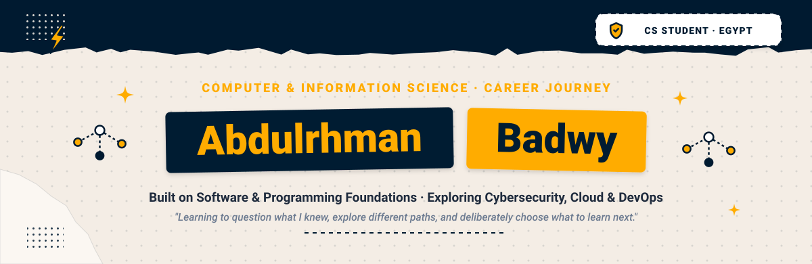
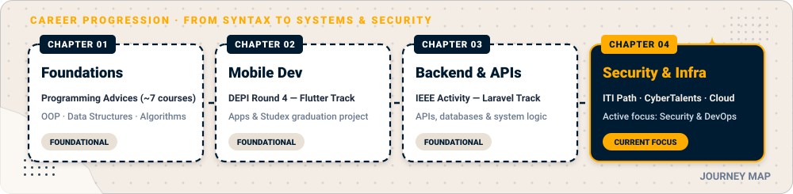
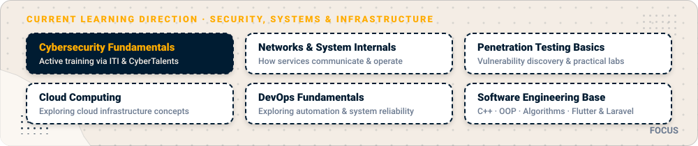
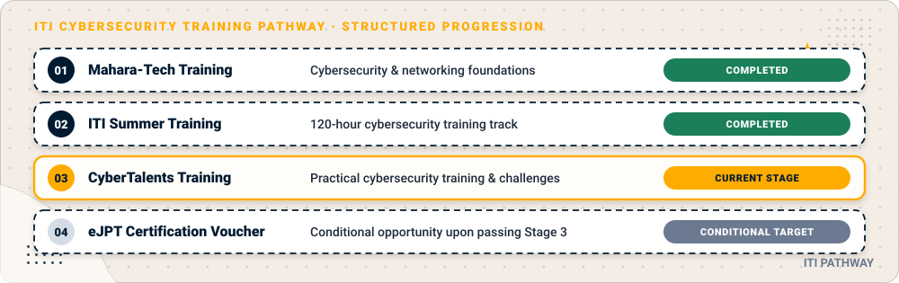
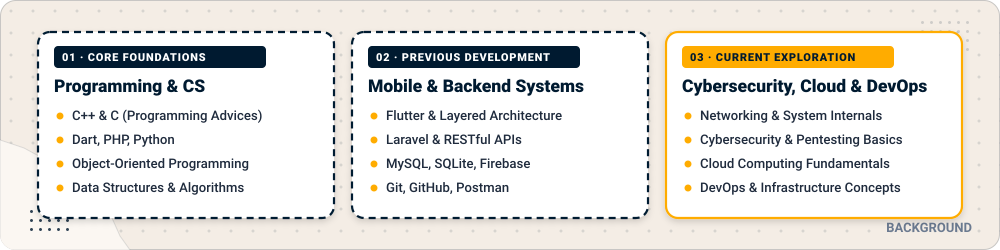
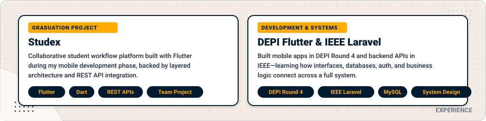
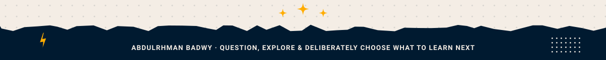

 

 

  &nbsp;
  &nbsp;
  &nbsp;
  

> *"I started out thinking I had a lot to prove. Over time, I realized how much I still had to learn. I explored different areas of software development, built projects, worked with others, and learned that discovering what is right for me is part of becoming a better engineer. Now, I am exploring cybersecurity and infrastructure, building on the programming foundations and development experience I gained along the way."*

---

   Chapter 2 Mobile Dev -> Chapter 3 Backend & APIs -> Chapter 4 Security & Infra" width="100%"/>

### The Turning Point

I am a **Computer and Information Science** student from Egypt 🇪🇬. In high school, I scored high enough to pursue engineering, but I chose Computer and Information Science because I felt genuinely drawn to the field and believed it suited me better.

When I first started college, I had an unrealistic picture of myself. I assumed I was already ahead and that very few people could compete with me. Reality humbled me quickly. Being surrounded by peers at different levels—many of whom knew far more than I did—made me realize how vast the field actually is and how much I had not yet explored.

Instead of trying to protect that old image of myself, I started asking a much more useful question:

> **How do I actually become good at this field?**

### Chapter 1 — Building the Foundations

I went back to the basics and worked on my programming fundamentals through **Programming Advices** by **Abu Hadhoud**, completing around seven courses. Alongside my self-study, I focused on core computer science subjects at college, including **Object-Oriented Programming (OOP)**, **Data Structures**, and **Algorithms**.

That phase taught me a lasting lesson: becoming a good engineer requires more than memorizing syntax or picking up a framework. It requires understanding the foundations underneath the tools.

### Chapter 2 — Exploring Mobile Development

Once I had a stronger foundation, I wanted to test myself in a practical development track. I joined the **Digital Egypt Pioneers Initiative (DEPI), Round 4**, in the **Flutter** track.

During DEPI and my college studies, I built several mobile applications and worked with my colleagues on **Studex**, our graduation project. Working on real deliverables taught me how applications are structured, how teams collaborate, and what it takes to turn requirements into working software.

### Chapter 3 — Looking Beyond the Interface

While building mobile interfaces, I wanted to understand what happens on the other side of an application. I started learning backend development with **Laravel** through the **IEEE** student activity—exploring REST APIs, relational databases, authentication, and server-side business logic.

Seeing both the client and server sides gave me a much clearer picture of how software systems fit together. At the same time, hands-on experience in mobile and backend development helped me realize that application development was not the area where I wanted to invest my long-term focus. I do not regret the time I spent there—it gave me practical engineering context and helped me figure out what I wanted to explore next.

### Chapter 4 — Exploring Cybersecurity and Infrastructure

My curiosity gradually shifted toward **Cybersecurity**, **Cloud Computing**, and **DevOps**. Rather than focusing only on building features, I became interested in how systems work internally, how networks and services communicate, how vulnerabilities arise and are discovered, and how infrastructure is secured and operated reliably.

---

  

Right now, I am focused on building strong fundamentals in **cybersecurity** through structured study and hands-on practice, while beginning to explore **cloud computing** and **DevOps**:

- **Active Cybersecurity Training:** Working through the **ITI cybersecurity pathway** and practicing hands-on challenges on **CyberTalents**.
- **Systems & Networking Mindset:** Studying how networks, operating systems, and web backends behave under the hood—where my earlier work with APIs, databases, and application architecture directly helps me reason about targets and systems.
- **Exploring Cloud & DevOps:** Learning the fundamentals of cloud infrastructure and DevOps workflows as long-term growth areas alongside security.

---

  

My current cybersecurity learning follows the **Information Technology Institute (ITI)** training pathway:

| Stage | Milestone | Focus | Status |
| :--- | :--- | :--- | :--- |
| **Stage 1** | **Mahara-Tech Training** | Entry-level cybersecurity and networking foundations | ✅ Completed |
| **Stage 2** | **ITI Summer Training** | Intensive **120-hour** cybersecurity training track | ✅ Completed |
| **Stage 3** | **CyberTalents Training** | Practical cybersecurity exercises and hands-on challenges | 🔄 Currently Undertaking |
| **Stage 4** | **eJPT Certification Voucher** | Opportunity to sit for the *Junior Penetration Tester (eJPT)* exam, conditional on passing Stage 3 | 🎯 Conditional Future Opportunity |

---

  

| Category | Technologies & Concepts | Context |
| :--- | :--- | :--- |
| **Programming & CS Foundations** | `C++` `C` `Python` `Dart` `PHP` · OOP, Data Structures, Algorithms | Built through Programming Advices (~7 courses) and university coursework |
| **Previous Application Development** | `Flutter` `Laravel` `REST APIs` `MySQL` `SQLite` `Firebase` `Git` `GitHub` `Postman` | Hands-on project experience from DEPI Round 4, Studex, and IEEE |
| **Current Exploration (Learning)** | `Cybersecurity Fundamentals` `Networking` `Penetration Testing Basics` `Linux` `Cloud Concepts` `DevOps Basics` | Active training and foundational study—areas I am currently developing |

   
  

---

  

My earlier development projects remain an important part of my journey—they taught me how real applications are built, structured, and connected before I shifted my focus toward security and infrastructure:

- **🎓 Studex (Graduation Project):** A collaborative student workflow platform built with **Flutter** and backed by a **Laravel** API. We structured the app around clean, layered boundaries separating presentation, domain, and data, handling authentication, persistence, and business rules end to end.
- **📱 DEPI Round 4 — Flutter Track Applications:** A series of mobile applications built during the **Digital Egypt Pioneers Initiative (Round 4)**, where I practiced state management, modular folder structures, and working within a development team.
- **🔗 Backend APIs — IEEE Laravel Track:** RESTful backend services built with **Laravel** and **MySQL** during my time with the **IEEE** student activity, focusing on token-based authentication, request validation, resource controllers, and API contracts consumed by mobile clients.

---

 

<picture>
  <source media="(prefers-color-scheme: dark)" srcset="https://raw.githubusercontent.com/AbdulrhmanBadwy/AbdulrhmanBadwy/output/github-contribution-grid-snake-dark.svg">
  <source media="(prefers-color-scheme: light)" srcset="https://raw.githubusercontent.com/AbdulrhmanBadwy/AbdulrhmanBadwy/output/github-contribution-grid-snake.svg">
  
</picture>

---

I am always open to connecting with fellow students, engineers, and security learners.

  &nbsp;
  &nbsp;
  &nbsp;
  

 

