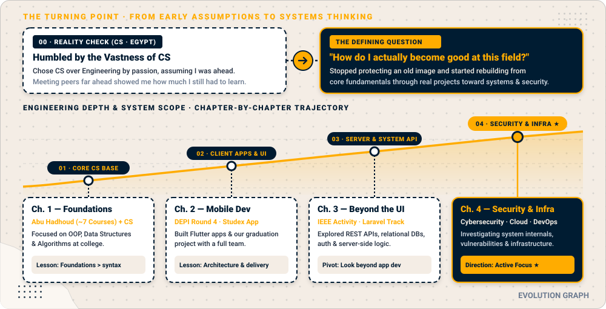

 

 

  &nbsp;
  &nbsp;
  &nbsp;
  

> *"I started out thinking I had a lot to prove. Over time, I realized how much I still had to learn. I explored different areas of software development, built projects, worked with others, and learned that discovering what is right for me is part of becoming a better engineer. Now, I am exploring cybersecurity and infrastructure, building on the programming foundations and development experience I gained along the way."*

---

   Chapter 2 Mobile Dev -> Chapter 3 Backend & APIs -> Chapter 4 Security & Infra" width="100%"/>

  

> 💡 **The Turning Point —** *"Instead of trying to protect an old image of myself after being humbled early in college, I started asking a much more useful question: **How do I actually become good at this field?**"*

---

  

Right now, I am focused on building strong fundamentals in **cybersecurity** through structured study and hands-on practice, while beginning to explore **cloud computing** and **DevOps**:

- **Active Cybersecurity Training:** Working through the **ITI cybersecurity pathway** and practicing hands-on challenges on **CyberTalents**.
- **Systems & Networking Mindset:** Studying how networks, operating systems, and web backends behave under the hood—where my earlier work with APIs, databases, and application architecture directly helps me reason about targets and systems.
- **Exploring Cloud & DevOps:** Learning the fundamentals of cloud infrastructure and DevOps workflows as long-term growth areas alongside security.

---

  

---

  

| Category | Technologies & Concepts | Context |
| :--- | :--- | :--- |
| **Programming & CS Foundations** | `C++` `C` `Python` `Dart` `PHP` · OOP, Data Structures, Algorithms | Built through Programming Advices (~7 courses) and university coursework |
| **Previous Application Development** | `Flutter` `Laravel` `REST APIs` `MySQL` `SQLite` `Firebase` `Git` `GitHub` `Postman` | Hands-on project experience from DEPI Round 4, Studex, and IEEE |
| **Current Exploration (Learning)** | `Cybersecurity Fundamentals` `Networking` `Penetration Testing Basics` `Linux` `Cloud Concepts` `DevOps Basics` | Active training and foundational study—areas I am currently developing |

   
  

---

  

---

 

<picture>
  <source media="(prefers-color-scheme: dark)" srcset="https://raw.githubusercontent.com/AbdulrhmanBadwy/AbdulrhmanBadwy/output/github-contribution-grid-snake-dark.svg">
  <source media="(prefers-color-scheme: light)" srcset="https://raw.githubusercontent.com/AbdulrhmanBadwy/AbdulrhmanBadwy/output/github-contribution-grid-snake.svg">
  
</picture>

---

I am always open to connecting with fellow students, engineers, and security learners.

  &nbsp;
  &nbsp;
  &nbsp;
  

 

